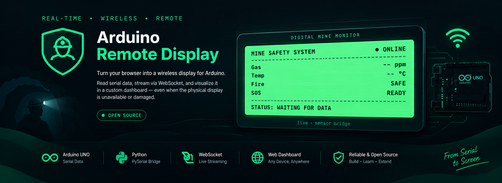

<p align="center">
  
</p>

<p align="center">
  <b>Turn your browser into a remote display for Arduino.</b>
</p>

<p align="center">
  A practical approach to viewing Arduino serial data on a web dashboard
  using Python, PySerial, and WebSockets.
</p>

---

## 💡 About

What if your Arduino's physical display stops working, or your project needs a display that can be accessed remotely?

**Arduino Remote Display** demonstrates an alternative approach: read data from an Arduino over serial communication, transmit it through a network-connected computer or server, and visualize it in a web dashboard.

Instead of depending entirely on a physical display, you can use a browser to view the data.

This project originated from an underground mine safety monitoring system built around an Arduino UNO.

## ✨ Key Features

- **Serial Data Reading:** Read Arduino data using Python and PySerial.
- **WebSocket Communication:** Stream data to a connected web interface.
- **Web Dashboard:** Visualize incoming data in a custom UI.
- **Remote Access:** View data from another device when the server and network are configured appropriately.
- **Reusable Approach:** Adapt the communication workflow for other Arduino-based projects.

*Features reflect the implemented components; check the project status and source code before assuming every capability is available.*

## 🏗️ Architecture

```text
┌──────────────────┐
│    Arduino UNO   │
│ Sensors / Inputs │
└────────┬─────────┘
         │
         │ Serial / USB
         ▼
┌──────────────────┐
│  Python Bridge   │
│     PySerial     │
└────────┬─────────┘
         │
         │ Network Communication
         ▼
┌──────────────────┐
│  WebSocket       │
│  Server          │
└────────┬─────────┘
         │
         ▼
┌──────────────────┐
│  Web Dashboard   │
│  Browser UI      │
└──────────────────┘
```

The exact communication flow depends on the implementation included in this repository.

## 🛠️ Technology Stack

- Arduino UNO
- Python
- PySerial
- WebSockets
- HTML, CSS, and JavaScript
- Network-connected computer or server

## 🚀 Getting Started

### Prerequisites

Before starting, you may need:

- Arduino UNO and a USB cable
- Python installed on your computer
- Arduino firmware compatible with the serial bridge
- A network connection for remote access
- A modern web browser

### 1. Clone the Repository

```bash
git clone https://github.com/kvinitkarmkar/arduino-remote-display.git

cd arduino-remote-display
```

### 2. Upload the Arduino Firmware

Open the Arduino sketch in the Arduino IDE and upload it to your Arduino UNO.

Check the `hardware/arduino-uno/` directory for the available firmware and instructions.

### 3. Configure the Python Bridge

Navigate to the bridge directory:

```bash
cd bridge
```

Install the dependencies if a `requirements.txt` file is provided:

```bash
pip install -r requirements.txt
```

Configure the serial port and baud rate according to the Arduino firmware and your system.

### 4. Start the Server

Follow the instructions in the `server/` directory to start the WebSocket server, if it is implemented as a separate component.

### 5. Open the Dashboard

Open the dashboard using the serving method supported by the project.

Configure the WebSocket endpoint to match the running server.

**Note:** These are general setup steps. Refer to the actual source code and component documentation for the exact commands, configuration, and startup order.

## 📂 Project Structure

```text
arduino-remote-display/
├── hardware/
│   └── arduino-uno/
├── bridge/
├── server/
├── dashboard/
├── docs/
├── examples/
├── README.md
└── LICENSE
```

## 🎯 Use Cases

This approach may be useful for:

- Arduino projects where a physical display is unavailable or damaged.
- Remote visualization of sensor readings.
- IoT prototypes and academic projects.
- Monitoring demonstrations and custom dashboards.
- Projects that need a browser-based interface instead of a dedicated display.

## ⚠️ Limitations

- Arduino UNO does not have built-in Wi-Fi; a connected computer or suitable networking hardware is required.
- Remote access depends on the bridge, server, network, and dashboard configuration.
- Serial communication settings must match the Arduino firmware.
- Network interruptions can interrupt live data transmission.
- This project is an experimental approach, not a certified monitoring solution.

**Safety Notice:** This project must not be treated as certified mine-safety equipment or used as the sole basis for safety-critical decisions.

## 🗺️ Roadmap

- [ ] Document the complete setup process.
- [ ] Add a system architecture diagram.
- [ ] Improve error handling and reconnection.
- [ ] Add a reproducible demonstration using simulated serial data.
- [ ] Document supported sensor-data formats.
- [ ] Test the complete workflow on real hardware.

## 🤝 Contributing

Contributions, bug reports, documentation improvements, and compatible hardware examples are welcome.

Before submitting a pull request, explain the proposed change and verify it against the existing implementation.

## 📜 License

See the `LICENSE` file for licensing terms.

---

<p align="center">
  Built to make Arduino projects easier to visualize, debug, and extend.
</p>
