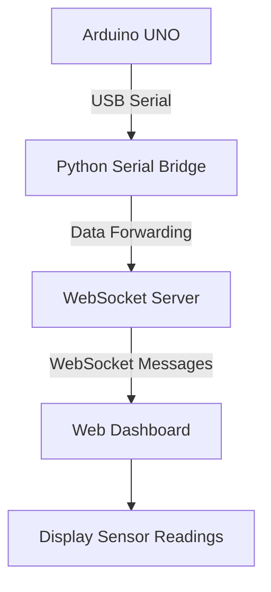
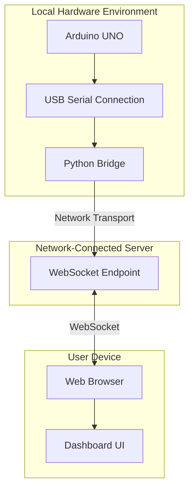

# System Architecture

## Arduino Remote Display

**A browser-based remote display for Arduino serial data using Python, PySerial, and WebSocket communication.**

---

## 1. Overview

Arduino Remote Display demonstrates an approach to displaying data collected by an Arduino on a remote web dashboard.

Instead of relying entirely on a physical display connected to the Arduino, the system reads serial data through a connected computer, processes it using Python, and makes it available to a web-based interface through network communication.

This approach can be useful when:
- A physical display is damaged or unavailable.
- A project needs a custom graphical interface.
- Sensor readings need to be viewed from another device.
- Developers want to visualize Arduino data in a browser.
- A prototype requires a flexible alternative to a dedicated display module.

The project originated from an underground mine safety monitoring prototype built around an Arduino UNO.

## 2. High-Level Architecture



### Components

| Component | Responsibility |
|---|---|
| Arduino UNO | Collects or generates data and transmits it over serial. |
| Python Serial Bridge | Reads serial data from the Arduino using PySerial. |
| WebSocket Server | Provides the network communication layer for the dashboard. |
| Web Dashboard | Presents incoming data through a custom graphical interface. |
| Network | Connects the dashboard to the server when remote access is configured. |

**Note:** This diagram represents the intended logical architecture. Refer to the actual source code to verify component boundaries and communication paths.

## 3. Data Flow

### Step 1: Data Generation

The Arduino UNO receives inputs from connected sensors or other data sources.

The firmware processes the inputs and transmits data through its serial interface.

The actual sensor types, data fields, units, and transmission format depend on the Arduino firmware.

### Step 2: Serial Communication

The Arduino connects to a computer through USB.

The computer exposes the Arduino's serial interface through a serial port.

The Python bridge uses PySerial to read incoming serial data.

The serial configuration must match the firmware, including:
- Serial port.
- Baud rate.
- Data format.
- Message delimiters, if applicable.

Incorrect configuration can prevent the bridge from receiving valid data.

### Step 3: Python Serial Bridge

The bridge reads data from the Arduino and prepares it for forwarding.

Depending on the implementation, this stage may handle:
- Serial input.
- Message framing.
- Basic input validation.
- Data forwarding.
- Serial connection errors.

The bridge should not be assumed to perform sensor calibration or safety-critical validation unless those functions are explicitly implemented.

### Step 4: WebSocket Communication

The WebSocket layer provides a communication channel between the server and connected dashboard clients.

A typical workflow is:

1. The dashboard connects to the WebSocket endpoint.
2. The server accepts the connection.
3. Incoming data is forwarded to connected clients.
4. The dashboard processes incoming messages.
5. The interface updates the displayed values.

The exact message format, connection lifecycle, and broadcasting behavior depend on the implementation.

### Step 5: Dashboard Rendering

The dashboard receives data from the configured server endpoint and renders it in a custom interface.

Depending on the implemented features, the interface may present:
- Sensor readings.
- Status indicators.
- Numerical measurements.
- Monitoring panels.
- Other application-specific information.

The dashboard is a visualization layer. Displaying a value does not independently establish that the measurement is accurate or that the underlying system is safe.

## 4. Deployment Architecture

The following is a conceptual deployment arrangement.



The Python bridge, WebSocket server, and dashboard do not necessarily run on separate machines.

Depending on the actual deployment, the bridge and server may run on the same computer, while the dashboard is hosted separately.

For remote access, the required server endpoint must be reachable from the client device.

A hosted dashboard alone does not provide access to an Arduino connected to another computer. The serial bridge and communication server must also be running and correctly configured.

## 5. Communication Layers

### Arduino to Python

**Transport:** USB serial communication.

**Purpose:** Transfer data from the Arduino to the computer.

The baud rate and serial message format must match on both ends.

### Python to Server

**Transport:** Depends on the implementation.

The bridge may communicate directly with a WebSocket server or use another transport layer.

Consult the bridge and server source code to identify the actual protocol.

### Server to Dashboard

**Transport:** WebSocket, if implemented as described.

WebSockets support ongoing, bidirectional communication between a client and server over a single connection.

The dashboard must use the correct endpoint and understand the message format sent by the server.

For a production deployment, use secure WebSocket connections (`wss://`) over HTTPS.

## 6. Data Format

The components must agree on how serial messages and network messages are represented.

For example, a possible JSON message might look like this:

```json
{
  "sensor": "example_sensor",
  "value": 25.4,
  "unit": "example_unit",
  "timestamp": "2026-01-01T12:00:00Z"
}
```

This is an illustrative example, not a claim about the existing project's actual message format.

Before adapting the system, inspect the Arduino firmware, Python bridge, server, and dashboard to identify the actual data schema.

A compatible implementation should define:
- Field names.
- Data types.
- Units of measurement.
- Message boundaries.
- Timestamp conventions.
- Handling of missing or invalid values.

## 7. Error Handling and Reliability

A remote display depends on multiple components operating correctly.

### Serial Connection Errors

Possible causes include:
- USB cable disconnection.
- Incorrect serial port.
- Incorrect baud rate.
- Another process occupying the serial port.

A robust bridge should report connection failures and handle reconnection where appropriate.

### Server Connection Errors

Network interruptions can prevent data from reaching the dashboard.

Potential improvements include:
- Connection status indicators.
- Reconnection logic.
- Clear error messages.
- Timeouts.
- Appropriate logging.

### Invalid Data

Malformed or incomplete messages should not be interpreted as valid measurements.

Input validation and explicit handling of unavailable readings can help avoid misleading displays.

### Stale Data

A dashboard may continue showing an old value after the connection is lost.

A future improvement could display the last update time and clearly indicate when data becomes stale.

These are recommended reliability measures; their presence in the current implementation must be verified.

## 8. Security Considerations

Remote monitoring introduces network security concerns.

Recommended precautions include:

- Use HTTPS and secure WebSockets in production.
- Avoid exposing development servers directly to the public internet.
- Protect sensitive server configuration and credentials.
- Restrict access to the server where necessary.
- Validate incoming data.
- Apply appropriate connection limits and access controls.
- Never commit API keys, passwords, or private credentials to the repository.

A public dashboard should not automatically expose sensitive information merely because the interface is accessible through a browser.

## 9. Limitations

The architecture has several practical limitations:

- Arduino UNO does not provide built-in Wi-Fi connectivity.
- The serial bridge requires a compatible connected computer.
- Remote viewing depends on network and server availability.
- Communication failures can interrupt data updates.
- Displayed values may be inaccurate if the sensors or firmware are incorrect.
- A web dashboard does not independently validate sensor calibration or measurement accuracy.

The complete system must be tested on the actual hardware and deployment environment.

## 10. Relationship to Mine Safety Monitoring

The original project was developed as part of an underground mine safety monitoring prototype.

The remote display approach can help demonstrate how sensor data might be presented through a custom web interface.

However, this repository is an educational and experimental project.

It is not certified mine-safety equipment and must not be relied upon as the sole basis for mine safety decisions.

Real mining applications require appropriate sensors, calibration, environmental testing, failure analysis, and compliance with applicable safety requirements.

## 11. Possible Future Improvements

Potential directions for future contributors include:

- [ ] Document the exact serial message format.
- [ ] Add a simulated serial data source.
- [ ] Improve serial reconnection handling.
- [ ] Add WebSocket connection status indicators.
- [ ] Detect and display stale data.
- [ ] Document the dashboard deployment process.
- [ ] Add automated tests for message parsing.
- [ ] Add configurable sensor mappings.
- [ ] Improve network security and access control.
- [ ] Test compatibility with additional Arduino projects.

These items are suggestions, not completed features.

## 12. Contributing

Contributors can help improve the documentation, reliability, compatibility, testing, and usability of the project.

Before proposing changes:
1. Review the existing source code.
2. Understand the current data flow.
3. Preserve compatibility with existing components where possible.
4. Document new configuration requirements.
5. Test changes against the available hardware or simulator.

See the repository's contribution guidelines for additional information.

---

**Project:** Arduino Remote Display  
**Purpose:** Remote visualization of Arduino serial data through a web dashboard.  
**Status:** Experimental prototype.
